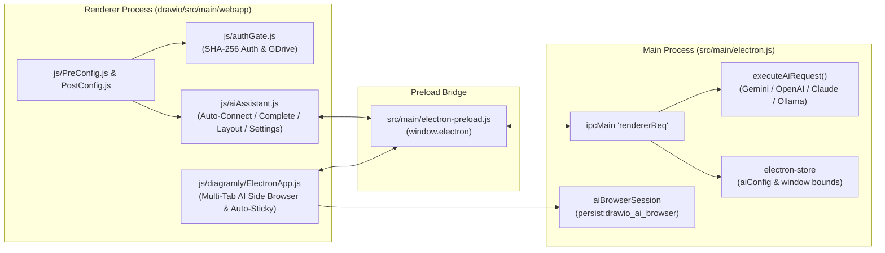

# CLAUDE.md - AI Assistant Guide for AI Diagram Editor (Desktop & Web)

## Project Overview

**AI Diagram Editor (AI Diagram Studio)** is an AI-powered, offline-first diagramming desktop and web application built on top of draw.io and Electron. In addition to full diagramming capabilities, it integrates multi-provider LLMs (Google Gemini, OpenAI, Anthropic Claude, and Ollama) for automatic flowchart connectivity (`Auto-Connect`), next-step prediction (`Auto-Complete`), and hierarchical `Auto-Layout`, alongside an embedded multi-tab AI Side Browser (with customizable favorites, Firefox UA OAuth compatibility, and real-time cookie persistence), an `Auto-Sticky Note` clipboard workflow, and a SHA-256 Web Authentication Gate for GitHub Pages deployments.

**Repository:** https://github.com/sofardogood/ai-diagram-desktop  
**Upstream Base:** https://github.com/jgraph/drawio-desktop  
**License:** Apache 2.0  
**Version:** see `drawio/VERSION` (stamped into `package.json` by `npm run sync`)

## Quick Reference

```bash
# Clone repository
git clone https://github.com/sofardogood/ai-diagram-desktop.git
cd ai-diagram-desktop

# Install dependencies
npm install

# Run application locally
npm start

# Run with DevTools enabled
DRAWIO_ENV=dev npm start

# Run unit tests
npm test

# Sync version and disable auto-update before building custom binaries
npm run sync -- disableUpdate

# Build unsigned macOS DMG (Apple Silicon)
DRAWIO_UNSIGNED=true CSC_IDENTITY_AUTO_DISCOVERY=false npx electron-builder --config electron-builder-linux-mac.json --mac dmg --arm64 --publish never
```

## Architecture & Data Flow (UML)



## Project Structure

```text
ai-diagram-desktop/
├── src/main/
│   ├── electron.js                  # Main Electron process: window management, IPC handlers, AI API router, AI browser session persistence
│   ├── electron-preload.js          # Secure IPC bridge with contextBridge (request, clipboard, file watch)
│   ├── args.js                      # CLI argument definitions and parser
│   ├── window-bounds.js             # Multi-monitor window bounds validation
│   ├── progress-bar.js              # Progress bar for CLI export operations
│   └── disableUpdate.js             # Generated by sync.cjs
├── src/test/
│   ├── cli-args.test.js             # CLI argument parsing tests (npm test)
│   ├── msi-project-created.test.js  # MSI shortcut icon hook tests (npm test)
│   └── window-bounds.test.js        # Window bounds validation tests (npm test)
├── drawio/src/main/webapp/          # Core draw.io web application + AI Studio extensions
│   ├── js/PreConfig.js              # Enforces light mode, default Japanese locale on Web, Google Drive App/Client IDs
│   ├── js/PostConfig.js             # Loads js/aiAssistant.js and js/authGate.js
│   ├── js/aiAssistant.js            # Universal AI Assistant plugin (Desktop IPC + Web Fetch fallback)
│   ├── js/authGate.js               # SHA-256 password gate & Google Drive login for Web/Cloud deployments
│   └── js/diagramly/ElectronApp.js  # Electron integration + Embedded Multi-Tab AI Side Browser, Bookmarks, Auto-Sticky Note
├── build/                           # Icons, macOS notarization, Windows signing, Electron security fuses, Quick Look extension
├── doc/
│   ├── RELEASE_PROCESS.md           # Release workflow documentation
│   └── BUILDING_FOR_PERSONAL_USE.md # Guide for unsigned fork/personal builds
├── .github/workflows/
│   ├── deploy-pages.yml             # Automatic deployment of drawio/src/main/webapp to GitHub Pages on push to main
│   ├── personal-build.yml           # Manual workflow for unsigned cross-platform builds
│   └── electron-builder*.yml        # Release build workflows
├── electron-builder-*.json          # Platform-specific build configs
├── sync.cjs                         # Version sync script
└── package.json
```

## Key Custom Modules & Implementation Details

| File | Purpose |
|------|---------|
| `src/main/electron.js` | Main process: manages `persist:drawio_ai_browser` session with real-time cookie flushing, Firefox User-Agent spoofing for OAuth compatibility, `getAiConfig` / `saveAiConfig` in `electron-store`, and `executeAiRequest` supporting Gemini (with 3.6/2.5/2.0/1.5-flash fallback), OpenAI, Claude, and Ollama. |
| `src/main/electron-preload.js` | Exposes `window.electron` (`request`, `registerMsgListener`, `sendMessage`, `listenOnce`, `clipboard.readText`, `clipboard.writeText`). |
| `drawio/src/main/webapp/js/aiAssistant.js` | Injects `AI ▾` and `ブラウザ ◨` buttons into `.geToolbar`; implements `runAutoConnect`, `runAutoComplete`, `runAutoLayout`, `showAiSettingsDialog`, and Web fallback for `window.drawioAiBrowser`. |
| `drawio/src/main/webapp/js/diagramly/ElectronApp.js` | Implements the desktop resizable `<webview>` Multi-Tab AI Side Browser, customizable Favorites bar (`.aiBrowserFavorites` in `localStorage`) with 1-click `☆/★` star button and right-click edit/delete modal, dynamic `.geEditor` layout shifting, and the 400ms clipboard polling watcher for Auto-Sticky Note mode. |
| `drawio/src/main/webapp/js/authGate.js` | Provides `window.drawioAuthGate` with SHA-256 password verification (default: `drawio-ai`), password change dialog, session remember token, and Google Drive login bypass for Web deployments. |

## Code Style & Conventions

- **ES6 modules** in `src/main/`, classic IIFE / ES5-compatible scripts in `drawio/src/main/webapp/js/`
- **Tab indentation** and **Allman brace style** (opening brace on a new line)
- **Light Mode Enforced**: Dark mode is permanently disabled across both `PreConfig.js`, `aiAssistant.js`, and `electron.js` (`nativeTheme.themeSource = 'light'`) to ensure consistent diagram legibility.
- **Security**: Keep `validateSender()` and `assertWritablePath()` intact for all filesystem IPC actions.
