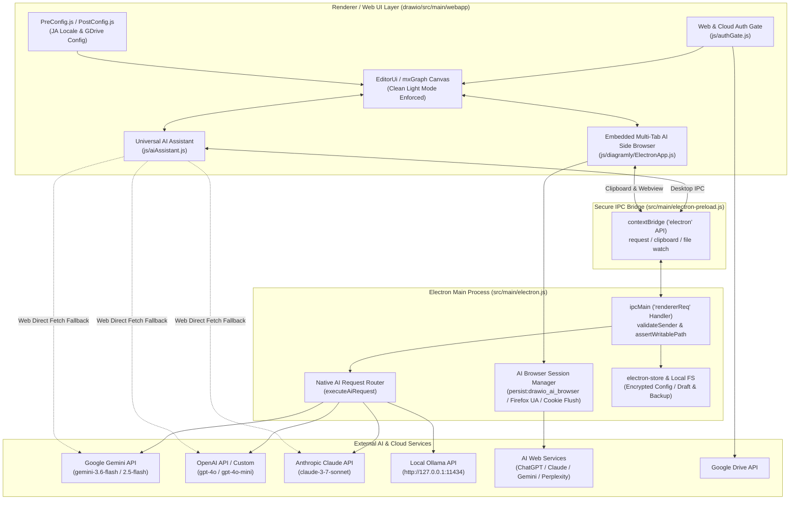
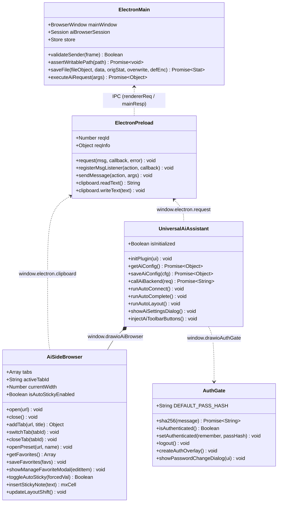
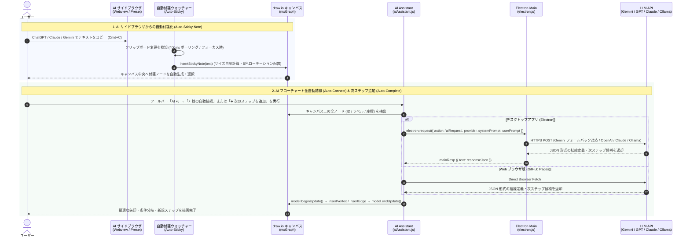

# AI Diagram Editor / Studio (Desktop & Web) 🚀

## 公開プレビューへのリンク

[ai-diagram-desktop を開く](https://sofardogood.github.io/ai-diagram-desktop/)

## 📖 リポジトリ概要 (Overview)

**AI Diagram Editor (AI Diagram Studio)** は、[draw.io (JGraph)](https://github.com/jgraph/drawio-desktop) および Electron をベースに構築された、**AIネイティブ・オフラインファーストの次世代ダイアグラム作成デスクトップ＆Webアプリケーション**です。

従来の作図機能に加え、マルチLLM（Google Gemini / OpenAI GPT-4o / Anthropic Claude / Ollama）を活用した**フローチャートの全自動結線（Auto-Connect）・次ステップ予測追加（Auto-Complete）・自動レイアウト整形（Auto-Layout）**を搭載しています。さらに、画面右側に常駐可能な**マルチタブ型 AI サイドブラウザ**（ChatGPT / Claude / Gemini / Perplexity 等へのシームレスな OAuth ログイン・リアルタイム Cookie 永続化・お気に入りブックマークバー搭載）や、コピーしたテキストを即座にキャンバス上の付箋へ変換する**自動付箋モード（Auto-Sticky Note）**、GitHub Pages / クラウド配信向けの**セキュア認証ゲート（Auth Gate）＆ Google Drive 統合**を備え、AIとの対話から構造化・図解までを単一ワークスペースで完結させます。

---

## 🏗 システムアーキテクチャ & UML 図 (Architecture & UML Diagrams)

### 1. コンポーネント構成図 (Component Architecture)



### 2. クラス図 (Class & Module Diagram)



### 3. シーケンス図: AI 自動結線・次ステップ生成 & 自動付箋ワークフロー (Sequence Diagram)



---

## ✨ 主な機能 (Key Features)

### 1. 🤖 AI フローチャートアシスタント (`drawio/src/main/webapp/js/aiAssistant.js`)
- **⚡ 線の自動接続 (Auto-Connect)**: キャンバス上に配置された複数の図形・テキストの意味と位置関係を AI が解析し、論理的なフローチャート矢印および条件分岐ラベル（Yes/No 等）を一括で自動結線します。
- **➕ 次のステップを追加 (Auto-Complete)**: 選択中または末端のノードから次に続くべき処理・判断ステップを AI が予測し、新しい図形と結線を自動生成します。
- **📐 自動レイアウト整形 (Auto-Layout)**: 階層型レイアウトアルゴリズム（`mxHierarchicalLayout`）により、複雑なダイアグラムをワンクリックで美しく整列します。
- **マルチモデル対応 & 自動フォールバック**:
  - **Google Gemini**: `gemini-3.6-flash` → `gemini-2.5-flash` → `gemini-2.0-flash` → `gemini-1.5-flash` の自動フォールバック機構を搭載。
  - **OpenAI**: `gpt-4o` / `gpt-4o-mini` 対応。
  - **Anthropic Claude**: `claude-3-7-sonnet` 対応。
  - **Ollama / Custom Endpoint**: ローカル LLM（`http://127.0.0.1:11434` 等）や OpenAI 互換カスタムエンドポイントに対応。
- **⚡ 接続テスト付き AI 設定モーダル**: API キーの疎通確認をその場で実行でき、キーはローカルの `electron-store` および設定領域に安全に保存されます。

### 2. 🌐 マルチタブ型 AI サイドブラウザ & お気に入りバー (`ElectronApp.js` / `electron.js`)
- **サイドバイサイド AI ワークフロー**: キャンバスの右側に ChatGPT、Claude、Gemini、Perplexity、Google 検索などを並べて常時表示できます。
- **マルチタブ管理**: 複数の Web タブを同時に開き、プロンプト入力や生成途中の状態を失わずにタブを切り替えられます。
- **⭐ カスタマイズ可能なお気に入りバー & 1クリック登録**:
  - 初期プリセット（🤖 ChatGPT / 🧠 Claude / ✨ Gemini / 🔍 Perplexity）に加え、「＋ 追加」ボタンや URL バー横の「☆/★」スターボタンから任意のサイト（DeepSeek、Notion、GitHub 等）をワンクリックでブックマーク登録・右クリック編集・削除できます。
- **シームレスな OAuth ログイン & リアルタイム Cookie 永続化**:
  - 専用パーティション `persist:drawio_ai_browser` と検証済み Firefox User-Agent の組み合わせにより、Google OAuth の `disallowed_useragent` ブロックを回避し、Google / ChatGPT / Claude へのログインとリアルタイム Cookie ディスク保存（`flushStore`）を実現しています。
- **ダイナミック・レイアウトシフト**: サイドブラウザの開閉やドラッグリサイズに合わせて draw.io キャンバス領域と右側の書式パネルが自動追従し、UI が隠れることなく 100% 操作可能です。

### 3. 📌 自動付箋モード (Auto-Sticky Note Mode)
- **コピー連動の自動付箋生成**:「📌 自動付箋: ON」にしておくと、サイドブラウザや外部アプリでテキストをコピー（`Cmd+C` / `Ctrl+C`）した瞬間に、キャンバス中央へ折れ耳付きのカラフルな付箋（5色パステルローテーション・文字数に応じた最適サイズ計算・カスケード配置）として自動挿入されます。
- **手動クイック付箋追加**: ブラウザツールバーの「📌 付箋化」ボタンや AI メニューからいつでも選択テキスト・クリップボード内容を付箋化できます。

### 4. 🔒 Web & クラウド版セキュア認証ゲート & クリーンライトモード
- **Web 認証ゲート (`drawio/src/main/webapp/js/authGate.js`)**: GitHub Pages 等の Web ホスティング環境向けに SHA-256 ハッシュ検証によるパスワードロック画面（初期パスワード: `drawio-ai`、変更・端末記憶・ロック機能付き）および Google Drive 連携ログインを提供します。
- **クリーンライトモード固定**: デスクトップ版・Web 版ともに視認性の高いライトモード UI を徹底し、ダークモードによる配色崩れを防止します。
- **日本語デフォルト UI**: Web 起動時も自動的に日本語（`lang=ja`）UI と AI ツールバーボタンが初期化されます。

### 5. 💾 ファイル管理・セキュリティ強化
- **ダイレクト上書き保存**: 既存ファイルのメタデータと認可パス（`blessedPaths`）を保持し、`Cmd+S` / `Ctrl+S` で即座に安全な同期 I/O 上書き保存（`.bkp` バックアップ・`.dtmp` ドラフト対応）が可能です。

---

## 📂 プロジェクト構造 (Project Structure)

```text
ai-diagram-desktop/
├── src/
│   ├── main/
│   │   ├── electron.js               # Electron メインプロセス (ウィンドウ管理, IPC, AI API ルーター, ブラウザセッション永続化)
│   │   ├── electron-preload.js       # ContextBridge によるセキュア IPC & クリップボードブリッジ
│   │   ├── args.js                   # CLI 引数パーサー
│   │   ├── window-bounds.js          # マルチディスプレイ対応ウィンドウ座標補正
│   │   ├── progress-bar.js           # CLI エクスポート用プログレスバー
│   │   └── disableUpdate.js          # 自動アップデート制御フラグ (npm run sync で生成)
│   └── test/                         # Node.js 組み込みテストランナー用ユニットテスト
├── drawio/                           # コア draw.io Web アプリケーション (統合ツリー)
│   └── src/main/webapp/
│       ├── index.html                # エントリ HTML
│       └── js/
│           ├── PreConfig.js          # 事前設定 (ライトモード強制, 日本語デフォルト, Google Drive Client ID)
│           ├── PostConfig.js         # プラグインローダー (aiAssistant.js / authGate.js の読み込み)
│           ├── aiAssistant.js        # Universal AI アシスタント (自動結線, 次ステップ追加, 自動整列, AI設定, Web用サイドブラウザ)
│           ├── authGate.js           # Web/Cloud 用 SHA-256 パスワード認証ゲート & Google Drive ログイン連携
│           └── diagramly/
│               └── ElectronApp.js    # Electron 統合レイヤー & マルチタブ AI サイドブラウザ・お気に入り・自動付箋実装
├── build/                            # アイコン, macOS Notarization, Windows 署名, Electron Fuses, Quick Look 拡張
├── doc/                              # 個人ビルド手順・リリースプロセスドキュメント
├── .github/workflows/                # GitHub Actions (GitHub Pages 自動デプロイ, マルチOSビルドワークフロー)
├── electron-builder-*.json           # プラットフォーム別 electron-builder 設定ファイル
├── sync.cjs                          # drawio/VERSION と package.json のバージョン同期スクリプト
└── package.json                      # 依存関係・スクリプト定義
```

---

## 🛠 セットアップ & ビルド手順 (Getting Started & Building)

### 必要環境 (Prerequisites)
- [Node.js](https://nodejs.org/) v22.12.0 以上（推奨: v22 LTS または v24 LTS）
- npm

### ローカル開発起動 (Installation & Run Locally)

```bash
# 1. リポジトリのクローン
git clone https://github.com/sofardogood/ai-diagram-desktop.git
cd ai-diagram-desktop

# 2. 依存パッケージのインストール
npm install

# 3. 開発モードで起動 (DevTools を開く場合は DRAWIO_ENV=dev npm start)
npm start
```

### テストの実行 (Running Tests)

```bash
npm test
```

### デスクトップバイナリのパッケージング (Packaging Desktop Binaries)

#### macOS (Apple Silicon / Intel)
```bash
npm run sync -- disableUpdate
DRAWIO_UNSIGNED=true CSC_IDENTITY_AUTO_DISCOVERY=false npx electron-builder --config electron-builder-linux-mac.json --mac dmg --arm64 --publish never
```

#### Windows
```powershell
$env:DRAWIO_UNSIGNED="true"
npm run sync -- disableUpdate
npx electron-builder --config electron-builder-win.json --publish never
```

#### Linux
```bash
npm run sync -- disableUpdate
npx electron-builder --config electron-builder-linux-mac.json --linux AppImage deb --x64 --publish never
```

---

## 📄 ライセンス & 謝辞 (License & Attribution)

本プロジェクトは [Apache License 2.0](LICENSE) の下で公開されています。

### Attribution
- 本ソフトウェアは **JGraph Ltd** によって開発・維持されている [drawio-desktop](https://github.com/jgraph/drawio-desktop) および [drawio](https://github.com/jgraph/drawio) をベースに機能拡張した派生オープンソースプロジェクトです。
- `draw.io` は JGraph Ltd の登録商標です。
